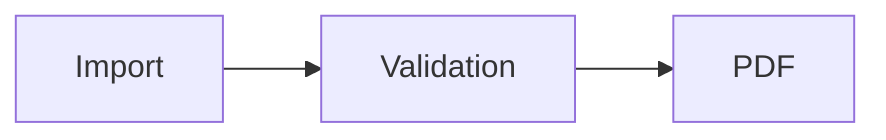

# Adliance QmDoc

[](https://dev.azure.com/adliance/QmDoc/_build/latest?definitionId=91&branchName=master)
[](https://www.nuget.org/packages/Adliance.QmDoc/)

## What is QmDoc
QmDoc is used by Adliance GmbH to automatically convert Markdown files to nicely formatted PDF files including corporate design guidelines.

## Installation
QmDoc is a .NET global tool. You'll need .NET 11 installed in order to install and use QmDoc.

Open your commandline and call

    dotnet tool install -g Adliance.QmDoc

to install QmDoc, or call

    dotnet tool update -g Adliance.QmDoc

to upgrade it to the latest version (or call `qmdoc update`, which does the same).

QmDoc needs network access: PDFs are rendered by the Adliance PDF service (`https://pdf2.adliance.dev`, the HTML of the document is sent there), and the PDF/HTML files load fonts from Google Fonts and Mermaid diagrams from `cdn.jsdelivr.net`.

## Usage
Once QmDoc is installed, you can convert all Markdown (`*.md`) files in a directory by calling `QmDoc` in that directory. You may also specify files or directories by using the `--source` parameter:

    qmdoc --source "c:\users\me\project\documentation"

or

    qmdoc --source "c:\users\me\project\documentation\my_awesome_document.md"

By default, only Markdown files directly inside the source directory are converted. Add `--include-subdirectories` to also look into all of its subdirectories:

    qmdoc --source "c:\users\me\project\documentation" --include-subdirectories

The resulting files are written to the current directory, or to the directory given with `--target`. If one of several files can't be converted (eg. because of an invalid frontmatter), the other files are still converted and QmDoc exits with an error at the end.

QmDoc supports the following commands:

- `pdf` (default command) converts Markdown to PDF.
- `html` converts Markdown to HTML.
- `pdf-and-html` converts Markdown to both PDF and HTML at once.
- `pdf-and-html-and-markdown` does the same as `pdf-and-html`, but additionally stores the processed Markdown (after all includes, placeholders etc. have been applied) that is fed into the HTML conversion. The target directory must differ from the source directory, otherwise the source files would be overwritten.
- `docx` converts Markdown to DOCX (only supports a subset of features compared to the PDF/HTML conversion).

For example, to convert to both PDF and HTML:

    qmdoc pdf-and-html --source "c:\users\me\project\documentation"

Instead of reading the source file, QmDoc can read the Markdown from standard input with `--stdin`. `--source` must then be the path of a single Markdown file, which is used to resolve includes, images, links and the Git history (it doesn't need to exist). With `--stdout`, the resulting file is written to standard output instead of the target directory, and all log messages go to standard error. `--source-lines` (only for `html`) adds `data-line` attributes with the zero-based line in the source file to all blocks, so editors can scroll the preview to the same position. This is how editors can convert unsaved changes:

    cat draft.md | qmdoc html --stdin --stdout --source-lines --source "c:\users\me\project\documentation\my_awesome_document.md" > preview.html

Call

    qmdoc --help 
    
to see all commands and parameters.

## VS Code Extension
The Adliance QmDoc Previewer extension for Visual Studio Code shows a live preview of the Markdown file next to the editor, rendered by QmDoc with the same theme as the PDF. The preview is updated on save, when you start a new line or paragraph, and after a short pause in typing, and it scrolls along with the editor. The extension installs QmDoc as .NET global tool if it's missing and keeps it up to date (you only need the .NET SDK).

To install it, download the `.vsix` file from the latest build of the extension pipeline (`azure-pipelines-vscode-extension.yml`) and install it in VS Code with "Extensions: Install from VSIX..." or with

    code --install-extension qmdoc-previewer-1.0.1.vsix

Then open a Markdown file and click the PDF icon in the editor title bar (or run "QmDoc: Open QmDoc Preview to the Side"). See the [extension's README](https://github.com/adliance/qmdoc/blob/master/src/Adliance.QmDoc.VsCodeExtension/README.md) for its settings.

## Themes
Themes define the look of the PDF and HTML files, so documents can match the corporate design of clients or projects. QmDoc comes with these themes:

- `2026` (default): the Adliance theme.
- `madx`: the theme for MADx documents.

To change the theme for all conversions, call

    qmdoc set-theme --theme madx

You can also set the theme for a single conversion with the `--theme` parameter (`qmdoc --theme madx`), or for a single document with `theme` in its frontmatter (which wins over `--theme`). An unknown theme is reported, and the default theme is used instead.

### Custom themes
A custom theme is a folder in `~/.qmdoc/themes/<name>` (`%USERPROFILE%\.qmdoc\themes\<name>` on Windows), which can then be used like the built-in themes. All files are optional, missing files are taken from the shared base of the built-in themes:

| File | Content |
|---|---|
| `*.css` | Styles, added after the shared base styles in alphabetical order of the file names. |
| `index.html` | The HTML page, with the placeholders `{{ TITLE }}`, `{{ CSS }}` and `{{ BODY }}`. |
| `header.html`, `footer.html` | Header and footer of each PDF page, they can use `{{ CSS }}`, `{{ TITLE }}`, `{{ GIT_DATE_VERSION }}` and the other placeholders. |
| `options.json` | PDF settings: `{ "pdf": { "header_height": 100, "footer_height": 80, "scale": 0.85, "timeout_seconds": 300 } }` |
| `*.md` | Partials that documents can [include](#includes), eg. a common legal notice. |

## Changelog
See the [Changelog](https://github.com/adliance/qmdoc/blob/master/CHANGELOG.md) for what's new in each version.

## Writing documents
QmDoc uses [Markdig](https://github.com/xoofx/markdig) with all its advanced extensions, so besides standard Markdown you can use tables, footnotes, task lists, ~~strikethrough~~, ==highlights==, ^superscript^, ~subscript~ and more. On top of that, QmDoc adds the features described below. The [Features Showcase](https://github.com/adliance/qmdoc/blob/master/examples/input/all-features.md) is a document that uses them (see `examples/output` for the resulting files).

### Frontmatter
Settings for a single document go into a YAML frontmatter at the very top of the file:

```markdown
---
title: Konzept Projektmeldungen
author: Hannes Sachsenhofer
watermark: Entwurf
Stundensatz: 135 €/h
---
```

| Key | Description |
|---|---|
| `title` | The document title. Without it, the file name is used. The `--title` parameter overrides it. |
| `author` | Shown as the author line below the title. |
| `theme` | The theme for this document, overrides the `--theme` parameter. |
| `watermark` | Text stamped diagonally over every page of the PDF, eg. "Entwurf". |
| `culture` | Culture for [calculations](#calculations), eg. `de-AT`. Default is `de-DE`. |
| `enableHeaderNumbering` | `false` turns off the automatic numbering of headings. |
| `enableDocumentTitle` | `false` hides the document title. |
| `enableHeader`, `enableFooter` | `false` hides the header or footer of the PDF. |
| `pdfWidth`, `pdfHeight`, `pdfScale`, `pdfTimeoutSeconds` | Fine-tuning of the PDF rendering. |

Every key, including your own ones (like `Stundensatz` above), can also be used as a placeholder (`{{ Stundensatz }}`) or in calculations.

### Headings
Write chapters as level 1 headings (`#`), sections as `##` and so on. Headings up to level 4 are numbered automatically (`1.`, `1.1.`, ...), so don't number them yourself. The table of contents shows headings up to level 5. The document title comes from the frontmatter, so there's no need for a title heading either.

Instead of the `author` frontmatter value, the first line of the document can be a level 4 heading with name, company and e-mail address, which is shown as author line (with a link to the e-mail address):

```markdown
#### Hannes Sachsenhofer | Adliance GmbH | name@example.com
```

### Placeholders
Placeholders are written in double curly braces. Upper/lower case and spaces don't matter, so `{{ TOC }}` and `{{toc}}` are the same. Placeholders in code (`` `{{ TOC }}` `` or code blocks) are left alone, so their syntax can be shown in a document.

| Placeholder | Replaced with |
|---|---|
| `{{ TOC }}` | A table of contents with links to all chapters (and page numbers in the PDF). |
| `{{ TITLE }}` | The document title. |
| `{{ DATE }}` | The current date, eg. "22. November 2026". |
| `{{ GIT_VERSION }}` | The short hash of the last Git commit that changed the document. |
| `{{ GIT_DATE }}` | The date of that commit. |
| `{{ GIT_DATE_VERSION }}` | Both, eg. "Version 8fa5220, 22. November 2026". |
| `{{ GIT_VERSIONS }}` | A table with the complete Git history of the document (date, person, version, change). Outside of a Git repository, a note says that the document is not under version control. |
| `{{ LINKED_DOCUMENTS }}` | A list of all [other documents](#links-to-other-documents) that this document links to. |
| `{{ include ./path/file.md }}` | The content of another Markdown file, see [Includes](#includes). |
| `{{ <frontmatter key> }}` | The value from the frontmatter, eg. `{{ Stundensatz }}`. |
| `{{ = <formula> }}` | The result of a calculation, see [Calculations](#calculations). |

The `--ignore-git-commits-since`, `--ignore-git-commits` and `--ignore-git-commits-without` parameters hide commits from the Git placeholders (eg. to only show released versions).

Additional placeholders can be defined in a JSON file (`placeholders.json` next to the document, or the file given with `--placeholders`), they are replaced in the final HTML. Unknown placeholders stay in the document as they are:

```json
{
  "CUSTOMER": "Medizinische Universität Wien"
}
```

### Callouts
A paragraph that starts with one of these placeholders is rendered as a highlighted block:

```markdown
{{?}} Should the old values be migrated as well?

{{!}} The export only contains measurements after 2020.

{{!!}} This deletes all data of the patient and cannot be undone.
```

| Placeholder | Block |
|---|---|
| `{{?}}` | Question (eg. open questions in a concept) |
| `{{!}}` | Note / warning |
| `{{!!}}` | Danger |

The callout must be a single paragraph. The same placeholders at the beginning of a list item add a small icon to that item:

```markdown
- {{?}} Is a password necessary?
- {{!}} Requires a restart of the service.
```

GitHub style alerts (`> [!NOTE]`, `> [!TIP]`, `> [!IMPORTANT]`, `> [!WARNING]`, `> [!CAUTION]`) are supported as well.

### Chapter links
`[#Chapter title]` links to a chapter. The link shows the chapter's full title including its number, eg. "2.1. Funktionsbeschreibung Projektmeldung".

- The title doesn't need to be complete: `[#Projektmeldung]` links to "Projektmeldung (Forschungsregister)". An exact title is preferred, then a title that starts with the text, then a title that contains it. If more than one chapter matches, QmDoc reports it.
- If multiple chapters have the same title, add (some of) their parent chapters, separated by `>`: `[#Projektmeldung > Offene Fragen]`.
- Links to chapters that don't exist are reported as warnings.

### Links to other documents
- `[other-document.md]` links to another Markdown file. QmDoc looks for it next to the document first, then searches for the file name in the folders around the source directory. In the PDF and the HTML, the link points to the PDF of that document. Other files work as well, eg. `[Kalkulation.xlsx]`.
- `[ABC-123]` links to the document whose file name starts with this document code, eg. `ABC-123 Verfahrensanweisung.md`. A document code is three letters or digits, a dash and three digits.

All linked documents can be listed with `{{ LINKED_DOCUMENTS }}`.

### Includes
`{{ include ./includes/legal-notice.md }}` inserts another Markdown file. The path is relative to the current document, or to the folder of a [custom theme](#custom-themes) (for partials shared by a theme). Includes are resolved first, so headings in included files are numbered and appear in the table of contents, and placeholders in them are replaced. The frontmatter of an included file is ignored. Includes can be nested, circular includes are reported as an error.

Documents named `<name>.<language>.md` (eg. `report.de.md`) automatically include the same language version of a file if it exists (`partial.de.md` instead of `partial.md`).

### Page breaks
A line containing only `---` starts a new page in the PDF. (The `---` lines of the frontmatter don't, and `***` or `___` stay horizontal rules.)

### Images
Images are centered, wide images are scaled down to fit the page. A caption is added with Markdig's figure syntax, and `{.left}` or `{.right}` places an image next to the text:

```markdown
^^^

^^^ Weight chart before the change

{.right} The text flows around the image.
```

### Diagrams
Fenced code blocks with the language `mermaid` are rendered as [Mermaid](https://mermaid.js.org/) diagrams:

````markdown

````

## Calculations
QmDoc can calculate values in your Markdown, for example hours and costs in an estimate. It keeps track of units, so hours stay hours and euros stay euros, and the results are written into the PDF, HTML, DOCX and processed Markdown.

```markdown
---
Stundensatz: 135 €/h
---

The implementation takes {{ = 40h + 90min }} and costs {{ = (40h + 90min) * Stundensatz }}.
```

becomes

> The implementation takes 41,5h and costs 5.602,50 €.

### Formulas
A formula is written as `{{ = ... }}`. Just like in Excel, every calculation starts with `=`. It distinguishes formulas from other placeholders like `{{ TOC }}` or `{{ Stundensatz }}` (which inserts the frontmatter value as text, without calculating anything). Spaces are optional, `{{ =[Stunden]*Stundensatz }}` works as well.

| What | Example | Result |
|---|---|---|
| Basic arithmetic `+ - * /` (also `×`, `·`, `÷`) | `{{ = 145h * 2€ }}` | 290€ |
| Parentheses | `{{ = (12h + 4h) * 2 }}` | 32h |
| Percentages | `{{ = 1.200€ * 20% }}` | 240€ |
| Negative numbers | `{{ = -5h + 8h }}` | 3h |
| Frontmatter values, by name | `{{ = 145h * Stundensatz }}` | 19.575 € |

Formulas inside code blocks and inline code (`` `{{ = 1 + 1 }}` ``) are left alone.

### Frontmatter values
Any value from the frontmatter can be used in a formula by writing its name without curly braces or brackets (names are case-insensitive). The value itself can contain a number with a unit, like `Stundensatz: 135 €/h`, `Pauschale: 1.500€` or `Stundensatz: € 135,-`.

### Units
Every number can have a unit, written directly after it (`12h`, `12 h`, `90€`, `90 €/h`). Currency symbols can also be written in front of the number (`€ 90`).

- **Adding and subtracting** is only possible with the same unit. `12h + 5€` is an error.
- **Minutes are converted to hours** automatically: `90min + 1h` = `2,5h`.
- **Compound units** like `€/h` are written without spaces around the `/`. `290€ / 145h` = `2€/h` and `12h * 90€/h` = `1.080€` (the hours cancel each other out).
- **Price shortcut:** multiplying anything with an amount of money is read as "quantity at that price", so `145h * 2€` is `290€` (and not `290 h·€`). The same works for other units like `3 Stk * 25€`.
- All other units (`Stk`, `km`, `PT`, ...) are kept as they are, but not converted into each other.

### Number format and culture
Numbers are parsed and formatted according to a culture, which is `de-DE` by default. Set `culture` in the frontmatter to use a different one:

```markdown
---
culture: de-AT
---
```

| Culture | Decimal separator | Thousands separator | Example |
|---|---|---|---|
| `de-DE` (default) | `,` | `.` | `1.234,50 €` |
| `de-AT` | `,` | space | `1 234,50 €` |
| `de-CH` | `.` | `'` | `1'234.50 €` |
| `en-US` | `.` | `,` | `1,234.50 €` |

A thousands separator is only recognized if it's followed by exactly three digits. So in `de-DE`, `12.5h` is reported as an error instead of silently becoming `125h`.

Results are written the way you write your numbers:

- **Decimals:** a result has as many decimals as the most precise number it was calculated from. It gets up to two more decimals if it needs them (`90min` = `1,5h`, `100min` = `1,67h`). Rounding is commercial, i.e. halves are rounded up (`0,01€ / 2` = `0,01€`).
- **Money** is shown without cents if all numbers are whole numbers (`290€`), otherwise with two decimals (`362,50€`). Within a table column, if one calculated amount has cents, all calculated amounts in that column are shown with cents, so the column looks consistent.
- **Whole amounts written as `135,-`** produce results like `€ 20.250,-` as well.
- **Spacing and position of the unit** follow the source: `90€` gives `290€`, `90 €` gives `290 €`, `€ 90` gives `€ 290`. If the result is money, the formatting of the amount of money in the formula is used. The space between number and unit is non-breaking, so they are never split across lines.

### Tables
Inside table cells, formulas can refer to other cells with square brackets, similar to Excel:

| Reference | Refers to |
|---|---|
| `[Kosten]` | The cell in the column "Kosten", in the same row |
| `[Kosten:3]` | The cell in the column "Kosten", in row 3 |
| `[Kosten:Summe netto]` | The cell in the column "Kosten", in the row whose first cell is "Summe netto" |
| `[4:3]` | The cell in column 4, row 3 |

- Columns are found by their header text, rows by the text in their first cell. Prefer the text: row numbers change when you insert a row, row labels don't.
- The text doesn't need to be complete: QmDoc first looks for the exact text, then for the number (starting at 1, the header row is not counted), then for a header or row that starts with the text, then for one that contains it. `[Stunden:Projektmanagement]` finds the row "Konzeption, Projektmanagement, Besprechungen". If more than one column or row matches, QmDoc reports it instead of guessing.
- Matching ignores upper/lower case, Markdown formatting like `**bold**`, and links: a row "**[#Projektmeldung]**" is found as "Projektmeldung".
- Square brackets are always table cells. Frontmatter values are written without brackets.

`{{ = SUM }}` adds up all values above it in the same column. Empty cells and cells containing only `-` are skipped, and so are other `{{ = SUM }}` cells. That means you can add subtotals, and a `{{ = SUM }}` at the bottom still sums up every row exactly once. `SUM` can also be part of a formula, like `{{ = SUM * 20% }}`. Formatting around a placeholder stays, so `**{{ = SUM }}**` is shown in bold.

A complete estimate:

```markdown
| Position         | Stunden       | Satz    | Kosten                                              |
|------------------|--------------:|--------:|----------------------------------------------------:|
| Konzept          | 12h           | 135 €/h | {{ = [Stunden] * [Satz] }}                          |
| Umsetzung        | 40h           | 120 €/h | {{ = [Stunden] * [Satz] }}                          |
| Abstimmungen     | 90min         | 135 €/h | {{ = [Stunden] * [Satz] }}                          |
| **Summe netto**  | **{{ = SUM }}** |       | **{{ = SUM }}**                                     |
| USt 20%          |               |         | {{ = [Kosten:Summe netto] * 20% }}                  |
| **Summe brutto** |               |         | **{{ = [Kosten:Summe netto] + [Kosten:USt 20%] }}** |
```

becomes

| Position         | Stunden   | Satz    | Kosten         |
|------------------|----------:|--------:|---------------:|
| Konzept          | 12h       | 135 €/h | 1.620,00 €     |
| Umsetzung        | 40h       | 120 €/h | 4.800,00 €     |
| Abstimmungen     | 90min     | 135 €/h | 202,50 €       |
| **Summe netto**  | **53,5h** |         | **6.622,50 €** |
| USt 20%          |           |         | 1.324,50 €     |
| **Summe brutto** |           |         | **7.947,00 €** |

If all rows use the same rate, put it in the frontmatter instead of a column: `{{ = [Stunden] * Stundensatz }}`.

### Errors
If a formula can't be calculated, QmDoc prints a warning with the reason (unknown name, different units, empty cell, circular reference, wrong decimal separator, a `{{ SUM }}` without `=`, ...). The formula itself stays in the document as written, so a missing value is never overlooked:

```
Calculation "{{ = 12h + 5€ }}": Cannot add "h" and "€".
Calculation "{{ = 12.5h * 2 }}": Unexpected "." at position 3 (the culture is "de-DE", so the decimal separator is "," and the thousands separator is ".").
```
