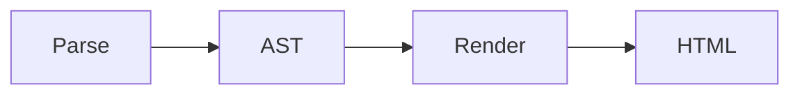

This example document is a showcase for all QmDoc features, using the latest 2026 theme. 
It is built by calling `qmdoc pdf-and-html-and-markdown --source "./examples/input" --target "./examples/output"`.


# 1. General QmDoc features
- The 2026 theme uses automatic hyphenation via CSS (`hyphens: auto;`).
- Headers are automatically numbered.
- PDF contain the outline metadata. Internally, this is also used to render the <span class="link-to-chapter"><i></i>[Table of Content](#table-of-content)</span>.
- Footer is added automatically for PDF, with document title, git version/date (if any) and page numbering.
- QmDoc supports separate `pdf`, `html`, `docx`, `pdf-and-html` and `pdf-and-html-and-markdown` commands, so you can generate each format on its own or several at once.
- The author from the frontmatter is shown below the title. Instead, a level 4 heading in the first line like `#### Name | Company | name@example.com` is shown as author line with an e-mail link.


# 2. Basic formatting

- Bold **asdf**
- Italic *asdf*
- Strikethrough ~~asdf~~
- Superscript ^asdf^
- Subscript ~asdf~
- Highlight ==asdf==
- Insert ++asdf++

Task lists and tables are supported as well:

- [x] Write the document
- [ ] Get it reviewed

| Format | Command | Notes |
|--------|---------|------:|
| PDF    | `pdf`   | default |
| HTML   | `html`  | single file, images embedded |
| Word   | `docx`  | subset of features |

Superscript^asdf^ and Subscript~asdf~ are not breaking up line height, because it looks shitty when lines 
suddenly have different visual ~heights~ on longer paragraphs like this one. 
Lorem ipsum dolor sit amet, consetetur sadipscing elitr, sed diam nonumy eirmod tempor invidunt ut labore et dolore magna aliquyam erat, sed diam voluptua. 
At vero eos et accusam et justo duo dolores et ea rebum. Stet clita kasd ^gubergren^, no sea takimata sanctus est Lorem ipsum dolor sit amet. 
Lorem ipsum dolor sit amet, consetetur sadipscing elitr, sed diam nonumy eirmod tempor invidunt ut labore et dolore magna aliquyam erat, sed diam voluptua. 
At vero eos et accusam et justo duo dolores et ea rebum. Stet clita kasd gubergren, no sea takimata sanctus est Lorem ipsum dolor sit amet.


## 2.1. Citations
""There's a proper way to format citations as well.""

# 3. Footnotes
Footnotes[^1] are supported[^note]. They are rendered at the end of the document and can be clicked.

[^1]: This is the first footnote content.
[^note]: Footnotes can have any label, not just numbers.


# 4. Chapter Linking
Links to chapters (to the anchor of the heading) are supported: <span class="link-to-chapter"><i></i>[General QmDoc features](#general-qmdoc-features)</span>. They will automatically include the heading numbering as well.

- The title doesn't need to be complete, as long as only one chapter matches: `[#Mermaid]` links to <span class="link-to-chapter"><i></i>[Mermaid](#diagrams-mermaid)</span>.
- If multiple chapters share the same title, add (some of) their parent chapters separated by `>` to pick the right one: `[#Images > Image captions]` links to <span class="link-to-chapter"><i></i>[Image captions](#image-captions)</span>. Ambiguous chapter links are reported as an error.
- Regular Markdown links to a chapter keep their own text: [see the calculations](#calculations).

QmDoc writes a warning if a link to a chapter is detected, but no matching heading.

## 4.1. Links to other documents
`[multi-language-example.md]` links to another Markdown file, which shows up as <span class="link-to-document"><i></i>[multi-language-example](multi-language-example.html)</span>. In the PDF and HTML, it points to the PDF of that document. A document code like `[QMD-001]` links to the document whose file name starts with that code: <span class="link-to-document"><i></i>[QMD-001 Document Codes](QMD-001%20Document%20Codes.html)</span>.

All documents linked from this document are listed with `{{ LINKED_DOCUMENTS }}`:

* <span class="link-to-document"><i></i>[multi-language-example](multi-language-example.html)</span>
* <span class="link-to-document"><i></i>[QMD-001 Document Codes](QMD-001%20Document%20Codes.html)</span>


# 5. Callouts (Alert Blocks)
## 5.1. Custom QmDoc Syntax
{{!}} This will be rendered as a warning/info block.

{{!!}} This will be rendered as a danger block.

{{?}} This will be rendered as a question block.

- {{!}} There's also
- {{?}} support for smaller callout icons
- {{!!}} inside a list, to put an emphasis on specific list items.

## 5.2. Standard Markdown Syntax
QmDoc also supports the GitHub style callouts. There's different flavors of this, but QmDoc supports the Markdig way and the theme just adds proper styling.

> [!NOTE]
> Useful information that users should know, even when skimming content.

> [!TIP]
> Helpful advice for doing things better or more easily.

> [!IMPORTANT]
> Key information users need to know to achieve their goal.

> [!WARNING]
> Urgent info that needs immediate user attention to avoid problems.

> [!CAUTION]
> Advises about risks or negative outcomes of certain actions.


# 6. Custom QmDoc Placeholders
- Current Date: 22. November 2026
- Document Title: QmDoc feature overview
- A `---` in its own line renders as a page break in PDF (`***` and `___` stay horizontal rules).
- {{ PRODUCT }} and {{ SUPPORT }} come from `placeholders.json` next to this document (or the file given with `--placeholders`).

## 6.1. Frontmatter values
Any key/value pair defined in the frontmatter can also be used as a placeholder, by its key. This works for arbitrary, custom keys, but also for the built-in ones like `title` or `author`. Besides `title` and `author`, the frontmatter can contain settings like `theme`, `watermark: Draft` (stamped over every page of the PDF), `culture` (for calculations), `enableHeaderNumbering: false`, `enableDocumentTitle: false` or `enableHeader: false`/`enableFooter: false`.

- Client: Adliance GmbH
- Project Code: QMD-2026
- Author (from frontmatter): Hannes Sachsenhofer

## 6.2. Includes (Partials)
Other Markdown files can be pulled into the current document with an include placeholder: write `include`, followed by a relative path to another Markdown file, wrapped in the same double curly braces used for `DATE` or `TOC` above. The path is resolved relative to the current file, or, if not found there, relative to the folder of a local theme in `~/.qmdoc/themes/<theme>` (useful for partials shared by a theme, like a common legal notice). The frontmatter of an included file is ignored.

Includes are resolved before any other processing happens, so headings inside an included file are numbered correctly, show up in the <span class="link-to-chapter"><i></i>[Table of Content](#table-of-content)</span>, and placeholders inside the included content (like the current date) are resolved as well. Includes can be nested, and circular includes are detected and reported as an error instead of looping forever.

The following heading and paragraph are pulled in from `partial-example.md`:

## 6.3. Included Partial Heading
This heading and paragraph live in a separate file, `includes/partial-example.md`. It gets merged into `all-features.md` at the position of the `{{ include }}` placeholder, before headers are numbered or the table of content is built - that's why this heading is numbered correctly and appears in the <span class="link-to-chapter"><i></i>[Table of Content](#table-of-content)</span> below. Placeholders also still work here, for example the current date: 22. November 2026.


## 6.4. Multi-language includes
Documents can be named `<filename>.<language-code>.md` (eg. `report.de.md`). When such a document includes another file, QmDoc first looks for a same-language version of the included file, and only falls back to the plain, non-translated file if no translated version exists. This works for nested includes too - the language of the top-level document is used throughout its entire include tree.

See `multi-language-example.md` and its German counterpart `multi-language-example.de.md` for a working, side-by-side example: both include the exact same `multi-language-partial.md`, but the German document automatically pulls in `multi-language-partial.de.md` instead - without any change to the include statement itself.

<div style="page-break-after: always;"></div>

## 6.5. Table of Content
The table of contents also links to the chapters. Page numbers are only filled in PDF output, not in HTML output.

<div class="toc">

| | |
|-|-:|
| [1. General QmDoc features](#general-qmdoc-features) |  |
| [2. Basic formatting](#basic-formatting) |  |
| &nbsp;&nbsp;&nbsp;&nbsp;&nbsp;[2.1. Citations](#citations) |  |
| [3. Footnotes](#footnotes) |  |
| [4. Chapter Linking](#chapter-linking) |  |
| &nbsp;&nbsp;&nbsp;&nbsp;&nbsp;[4.1. Links to other documents](#links-to-other-documents) |  |
| [5. Callouts (Alert Blocks)](#callouts-alert-blocks) |  |
| &nbsp;&nbsp;&nbsp;&nbsp;&nbsp;[5.1. Custom QmDoc Syntax](#custom-qmdoc-syntax) |  |
| &nbsp;&nbsp;&nbsp;&nbsp;&nbsp;[5.2. Standard Markdown Syntax](#standard-markdown-syntax) |  |
| [6. Custom QmDoc Placeholders](#custom-qmdoc-placeholders) |  |
| &nbsp;&nbsp;&nbsp;&nbsp;&nbsp;[6.1. Frontmatter values](#frontmatter-values) |  |
| &nbsp;&nbsp;&nbsp;&nbsp;&nbsp;[6.2. Includes (Partials)](#includes-partials) |  |
| &nbsp;&nbsp;&nbsp;&nbsp;&nbsp;[6.3. Included Partial Heading](#included-partial-heading) |  |
| &nbsp;&nbsp;&nbsp;&nbsp;&nbsp;[6.4. Multi-language includes](#multi-language-includes) |  |
| &nbsp;&nbsp;&nbsp;&nbsp;&nbsp;[6.5. Table of Content](#table-of-content) |  |
| &nbsp;&nbsp;&nbsp;&nbsp;&nbsp;[6.6. Git](#git) |  |
| [7. Calculations](#calculations) |  |
| &nbsp;&nbsp;&nbsp;&nbsp;&nbsp;[7.1. Calculations in text](#calculations-in-text) |  |
| &nbsp;&nbsp;&nbsp;&nbsp;&nbsp;[7.2. Calculations in tables](#calculations-in-tables) |  |
| [8. Images](#images) |  |
| &nbsp;&nbsp;&nbsp;&nbsp;&nbsp;[8.1. Image captions](#image-captions) |  |
| &nbsp;&nbsp;&nbsp;&nbsp;&nbsp;[8.2. Inline images](#inline-images) |  |
| [9. Diagrams (Mermaid)](#diagrams-mermaid) |  |

</div>


## 6.6. Git
- Version: 6983f77
- Date: 22. November 2026
- Date and Version: Version 6983f77, 22. November 2026

And a full Git changelog of the current document is also available, formatted as a table:

| Datum | Person | Version | Änderung | 
|-|-|-|-|
| 22.&nbsp;11.&nbsp;2026 | Hannes | 6983f77 | Add calculation examples. |
| 05.&nbsp;10.&nbsp;2026 | Hannes | f6c769b | Fix chapter-linking if there&#39;s multiple chapters with identical name. |
| 24.&nbsp;09.&nbsp;2026 | Hannes | 73070f3 | Add a new command that allows to create PDF/HTML/Markdown files in the same run. |

# 7. Calculations
QmDoc calculates formulas written as `{{ = ... }}` (every calculation starts with `=`, just like in Excel). Units like hours and euros are kept throughout, minutes are converted to hours, and numbers are parsed and formatted according to the `culture` frontmatter setting (default `de-DE`). Results are written the same way the numbers in the formula are written, eg. `90€`, `90 €`, `€ 90` or `135,-`.

## 7.1. Calculations in text
- `{{ = 145h * 2€ }}` = 290€ (multiplying with an amount of money is read as "at that price")
- `{{ = 90min + 1h }}` = 2,5h (minutes are converted to hours)
- `{{ = 290€ / 145h }}` = 2€/h (compound units)
- `{{ = 12h * 90 €/h }}` = 1.080 € (the hours cancel each other out)
- `{{ = 1.200€ * 20% }}` = 240€
- `{{ = € 135,- * 8 }}` = € 1.080,-

Frontmatter values are used by their name, without curly braces: at an hourly rate of 135 €/h, the implementation takes 41,5h and costs 5.602,50 €.

## 7.2. Calculations in tables
Inside a table, square brackets refer to other cells: `[Costs]` is the "Costs" cell in the same row, `[Costs:Total net]` the one in the row whose first cell is "Total net", and `[Costs:3]` or `[4:3]` use the row and column numbers. `{{ = SUM }}` adds up all values above it, except other `{{ = SUM }}` cells, so subtotals are not counted twice.

```markdown
| Position          | Hours           | Rate    | Costs                    |
|-------------------|----------------:|--------:|-------------------------:|
| Concept           | 12h             | 135 €/h | {{ = [Hours] * [Rate] }} |
| Implementation    | 40h             | 120 €/h | {{ = [Hours] * [Rate] }} |
| Meetings          | 90min           | 135 €/h | {{ = [Hours] * [Rate] }} |
| **Total net**     | **{{ = SUM }}** |         | **{{ = SUM }}**          |
| VAT 20%           |                 |         | {{ = SUM * 20% }}        |
| **Total gross**   |                 |         | **{{ = SUM }}**          |
```

| Position          | Hours           | Rate    | Costs                    |
|-------------------|----------------:|--------:|-------------------------:|
| Concept           | 12h             | 135 €/h | 1.620,00 € |
| Implementation    | 40h             | 120 €/h | 4.800,00 € |
| Meetings          | 90min           | 135 €/h | 202,50 € |
| **Total net**     | **53,5h** |         | **6.622,50 €**          |
| VAT 20%           |                 |         | 1.324,50 €        |
| **Total gross**   |                 |         | **7.947,00 €**          |

Rows and columns don't need their complete text, as long as only one of them matches (`[Hours:Impl]` finds "Implementation"):

```markdown
| Phase              | Hours                                                          |
|--------------------|---------------------------------------------------------------:|
| Concept            | 12h                                                            |
| Implementation     | 40h                                                            |
| Testing            | {{ = [Hours:Impl] * 25% }}                                     |
| Project management | {{ = ([Hours:Concept] + [Hours:Impl] + [Hours:Test]) * 10% }} |
| **Total**          | **{{ = SUM }}**                                                |
```

| Phase              | Hours                                                          |
|--------------------|---------------------------------------------------------------:|
| Concept            | 12h                                                            |
| Implementation     | 40h                                                            |
| Testing            | 10h                                     |
| Project management | 6,2h |
| **Total**          | **68,2h**                                                |

If a formula can't be calculated (eg. `{{ = 12h + 5€ }}`, because hours and euros can't be added), QmDoc writes a warning and leaves the formula in the document, so a missing value is never overlooked.


# 8. Images
Images are automatically centered. Wide images are resized to fit the space, 
while small images keep their original size,


## 8.1. Image captions
^^^

^^^ This is an image caption

## 8.2. Inline images
{.left} There's a way to render images in-line on either the left or the right side. 
This even works with captions. 

^^^

^^^ This is an image caption {.right}
Lorem ipsum dolor sit amet, consetetur sadipscing elitr, sed diam nonumy eirmod tempor invidunt ut labore et dolore magna aliquyam erat, sed diam voluptua.
At vero eos et accusam et justo duo dolores et ea rebum.

# 9. Diagrams (Mermaid)

